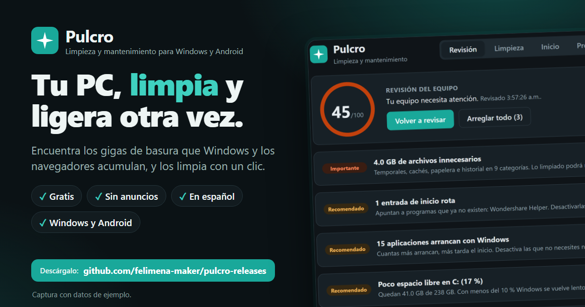
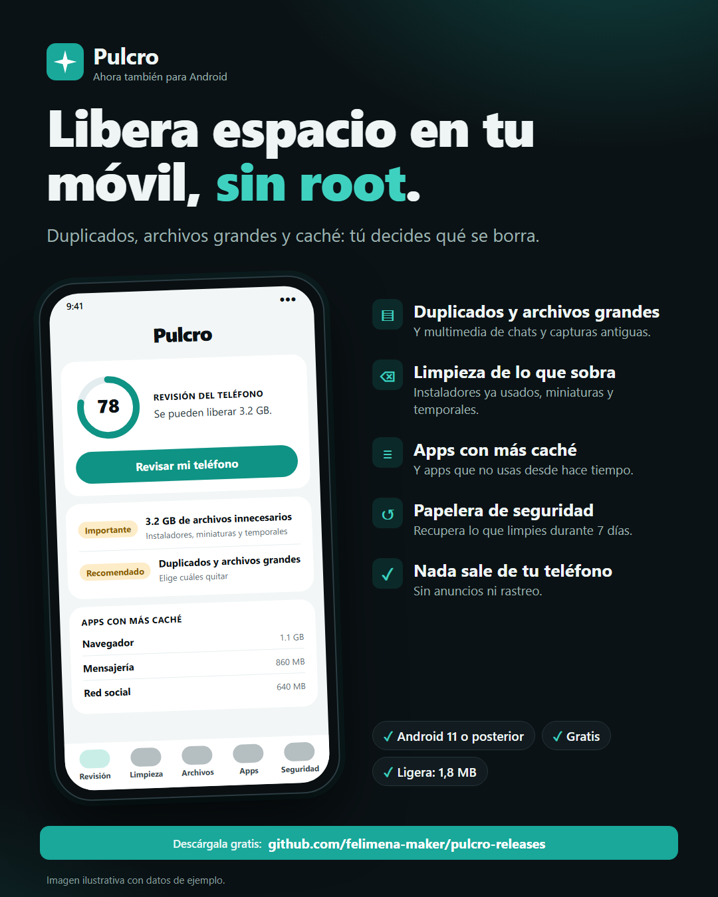
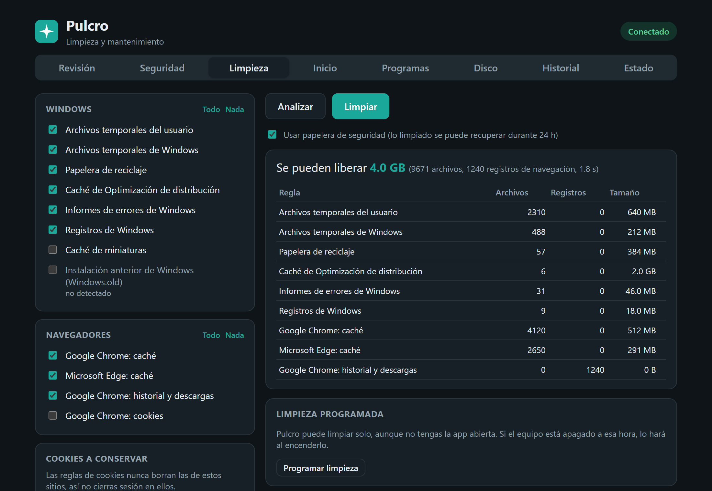
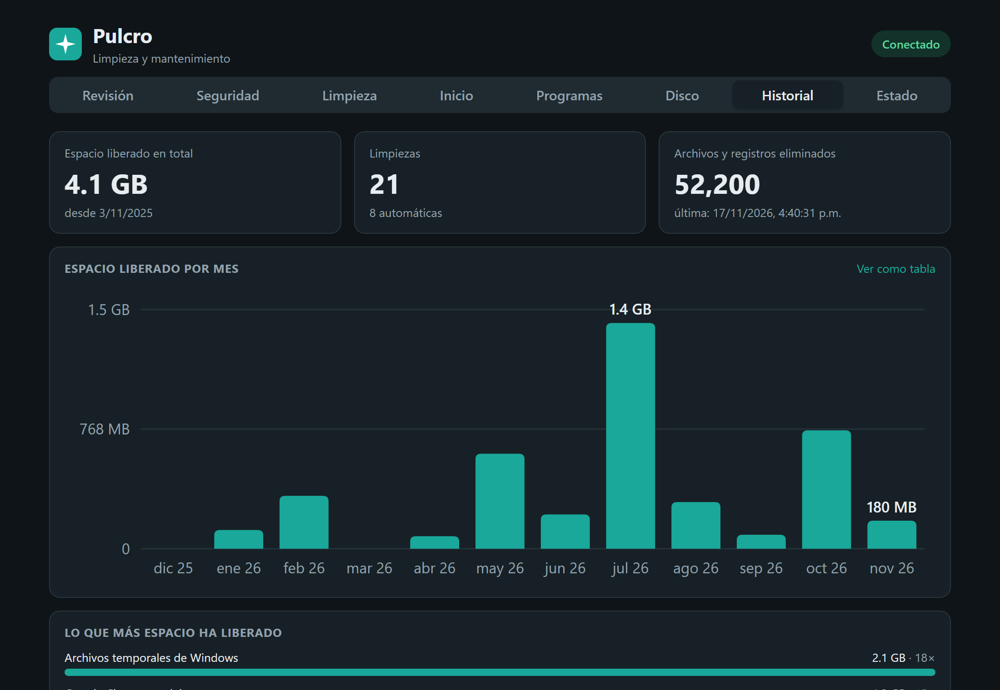
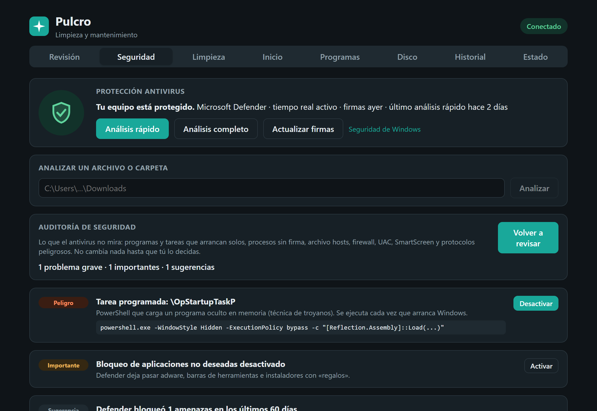
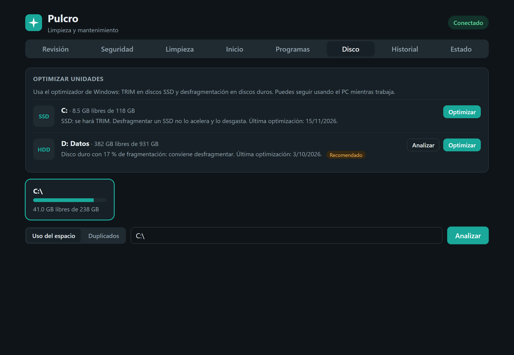

  

# Pulcro

**Limpieza, seguridad y mantenimiento para Windows 10/11 y Android.** Gratis, sin anuncios y en español.

### [⬇ Descargar la última versión](https://github.com/felimena-maker/pulcro-releases/releases/latest)

En la página que se abre, descarga:
- **Windows:** `Pulcro_x.y.z_x64-setup.exe`
- **Android 11 o posterior:** `Pulcro-android-x.y.z.apk`

## Qué hace

- **Revisión en un clic.** Una nota de 0 a 100 y qué conviene arreglar primero.
- **Limpieza profunda.** Temporales, cachés de Edge, Chrome, Brave, Opera y Firefox, papelera, informes de errores, caché de actualizaciones, Windows.old y más.
- **Historial y cookies del navegador**, conservando las sesiones de los sitios que elijas.
- **Arranque más rápido.** Activa o desactiva los programas que se abren al encender.
- **Programas.** Desinstala y busca los restos que dejan.
- **Analizador de disco.** Lo que más ocupa y los archivos duplicados, con vista previa.
- **Limpieza automática** programada, aunque no abras la app.
- **Icono en la bandeja** que te avisa cuando hay mucho para limpiar.
- **Seguridad:** controla Microsoft Defender (análisis rápido, completo o de una carpeta) y revisa lo que el antivirus no mira: programas que arrancan solos con técnicas de malware, archivo hosts, firewall, UAC y SmartScreen.
- **Optimizar unidades:** TRIM en SSD y desfragmentación en discos duros.
- **Actualizaciones automáticas** firmadas.

## Pulcro para Android

Sin root y de 2 MB: revisión del teléfono con nota de 0 a 100, limpieza de instaladores ya usados, miniaturas, temporales y estados de WhatsApp (con papelera de 7 días), las apps con más caché, apps sin usar y una auditoría de seguridad (apps que controlan la pantalla, administran el teléfono o leen notificaciones, parche de seguridad, depuración USB).

Para instalarlo, abre el `.apk` en el teléfono y permite instalar apps de esa fuente cuando Android lo pida. Al abrir Pulcro, concede «acceso a todos los archivos» y «acceso a datos de uso»: sin ellos no puede buscar basura ni medir las apps.

  

## Sin miedo a romper nada

- **Papelera de seguridad:** lo que Pulcro limpia se puede recuperar durante 24 horas.
- **Alertas de riesgo:** antes de borrar algo del disco, te dice si Windows o un programa lo necesitan.
- **Sin anuncios ni rastreo:** Pulcro no envía tus datos a ningún sitio.

  
  

  
  

Capturas con datos de ejemplo.

## Instalación

1. Descarga `Pulcro_x.y.z_x64-setup.exe` desde [Releases](https://github.com/felimena-maker/pulcro-releases/releases/latest).
2. Ábrelo y acepta el permiso de administrador: Pulcro instala un pequeño servicio para poder limpiar las carpetas del sistema.
3. Si Windows muestra **«Windows protegió su PC»**, pulsa **Más información → Ejecutar de todas formas**. Aparece porque el instalador aún no lleva un certificado de firma comercial.

Para desinstalarlo: *Configuración → Aplicaciones → Pulcro → Desinstalar*.

---

Las capturas muestran datos de ejemplo. Este repositorio sólo contiene los instaladores y las actualizaciones de Pulcro.
